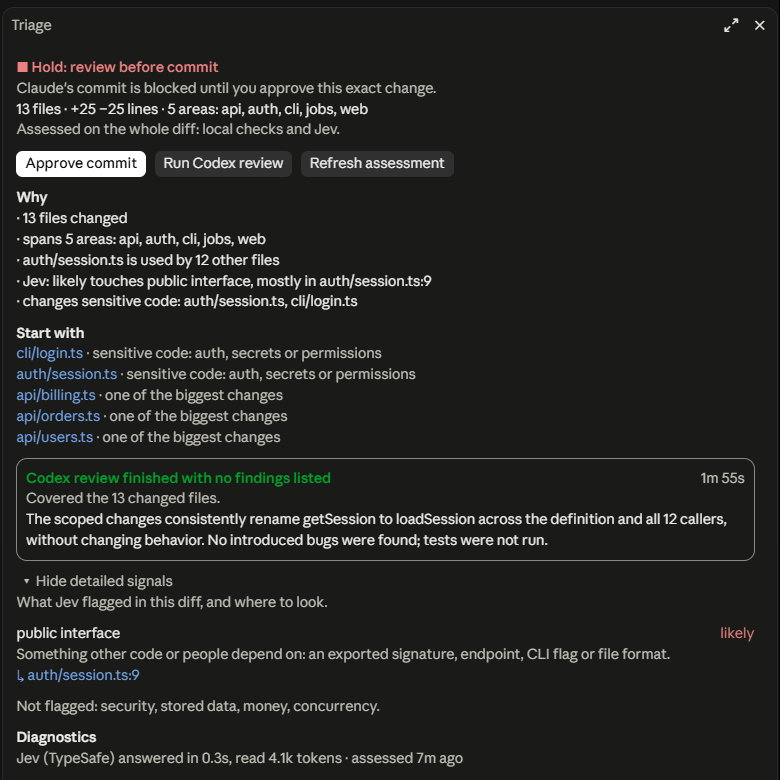
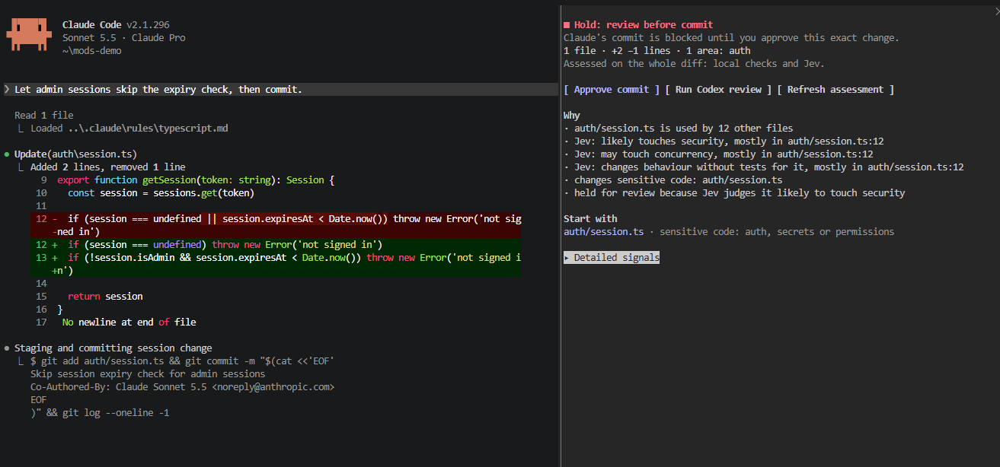
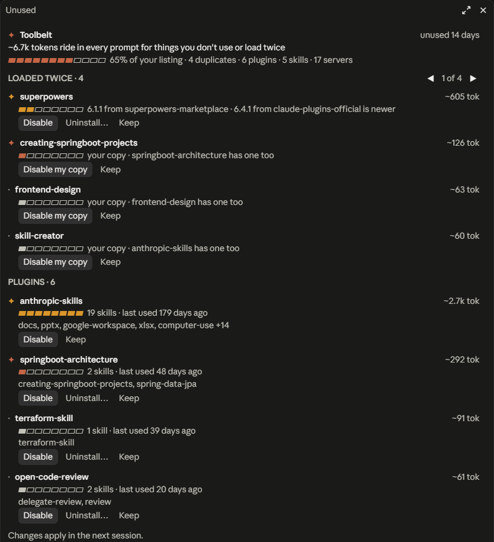
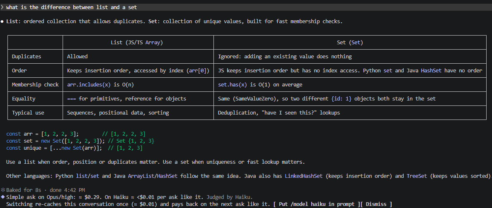

# claude-mods

Claude Code plugins that keep you in the loop while an agent writes your code.

| Plugin | Kind | In one line |
|---|---|---|
| [triage-gate](plugins/triage-gate) | mod | Stops risky commits until you have looked at them |
| [hindsight](plugins/hindsight) | mod | Spots the same snag coming back and offers a fix |
| [toolbelt](plugins/toolbelt) | mod | Finds the skills, plugins and MCP servers you never use |
| [model-fit](plugins/model-fit) | mod | Tells you when the model or effort is too big or too small for the ask |
| [quiz-me](plugins/quiz-me) | skill | Quizzes you on what the session changed |

A **mod** is a plugin that runs code inside Claude Code and can show you panes, bands, buttons and toasts. A **skill** is instructions Claude follows. Each plugin installs on its own. Click a name for the full details.

## Install

You need:

- A Claude Code build with mods (tested on 2.1.296; the mod API is early access and can change).
- Git, for triage-gate.
- Optional: the Codex CLI, for `/gate codex`.
- Optional: the `mattpocock-skills` plugin, for `/hindsight`'s hand-off to `/mattpocock-skills:retro`.

From the root of a clone:

```
claude plugin marketplace add .
claude plugin install triage-gate@my-mods
claude plugin install hindsight@my-mods
claude plugin install toolbelt@my-mods
claude plugin install model-fit@my-mods
claude plugin install quiz-me@my-mods
```

Sessions run an installed copy, so after editing a plugin here, bump its version in `plugin.json`, then run `claude plugin marketplace update my-mods` and `claude plugin update <plugin>@my-mods`, and start a new session.

Panes and bands only draw where the surface supports them. The terminal is tested, and so is the desktop app for the Triage pane.

## triage-gate

**What it does:** before Claude commits, it scores the change and picks one of three verdicts:

- **No review trigger:** the commit goes through. This does not mean the change is safe.
- **Review recommended:** the commit goes through, and a toast says why you should read it.
- **Hold:** the commit is blocked until you approve it.

The score looks at size, how many files depend on the changed ones, and sensitive paths (auth, secrets, `.env` ...). With a TypeSafe key, the Jev model also checks for security, data, money, concurrency and API risks.



A two-line change is held too when Jev judges it likely to touch security, and it names the line:



**How to use it:**

- `/gate` checks the current change and opens the Triage pane: the verdict, why, and which files to read first.
- `/gate approve` approves the change and puts the commit request back in your prompt box.
- `/gate details` prints everything as text.
- `/gate codex` asks Codex for a review of the changed files.

**Setup:** `claude plugin configure triage-gate@my-mods` to add a TypeSafe key (optional). Without one, it uses the local checks only.

**Data:** with a key, each check sends file paths and up to 60k characters of the diff to TypeSafe. Codex runs only when you ask.

**Why a mod:** it has to stop the commit, and the pane and buttons are how you review and approve.

## hindsight

**What it does:** watches for snags that waste time, such as lots of searching before an edit, the same command failing again and again, huge outputs, slow commands and refused calls. When the same snag shows up in a second session, it proposes one fix, for example a line for `CLAUDE.md` or a permission rule.


**How to use it:** a row above the prompt offers the fix. Pick **Save**, **Put task in prompt**, **Skip** or **Not in this repo**. Once a fix stays clear for five sessions, hindsight marks it as held. `/hindsight` lists all snags for the repo.

**Why a mod:** it has to see every tool call, and you answer a fix with one click.

## toolbelt

**What it does:** lists the plugins, skills and MCP servers nobody used in the last 14 days, with what each one costs in tokens on every prompt. It also flags anything loaded twice.



**How to use it:** `/unused` opens the list. Each row has **Disable**, **Remove** or **Keep**. Every action asks you to confirm and applies in the next session. A toast reminds you at most once a day.

**Setup:** `claude plugin configure toolbelt@my-mods` to change the window (7 to 90 days).

**Why a mod:** it reads what the session actually loaded, which config files alone do not show.

## model-fit

**What it does:** after each ask you type, Haiku labels it trivial, routine or complex. A dim line then shows that label, the model and effort it ran on, and the rough cost. If you used more model than needed (or too little), it suggests `/model` or `/effort`, and tells you if switching would cost more than it saves. It also warns when the context gets expensive.



**How to use it:** read the band; buttons put the suggested command in your prompt box. It never switches anything itself.

- `/fit` shows your history and session totals.
- `/model-fit:baton` writes a handoff note to paste after `/clear`.

**Setup:** optional, via `claude plugin configure model-fit@my-mods`: set `cacheTtl`, or turn on Jev shadow labels to compare Jev with Haiku.

**Why a mod:** the advice is for you, not Claude. A hook's output goes into Claude's context and costs tokens.

## quiz-me

Run `/quiz-me:quiz`. It asks one to three questions about what the session changed and checks your answers against the code. The score is a check on your own understanding, not a merge verdict.

## Development

```
claude plugin validate plugins/<plugin>
claude plugin test plugins/<plugin>
claude plugin validate .
```

[HANDOFF.md](HANDOFF.md) covers mod layout, current state and open questions. [API-LESSONS.md](API-LESSONS.md) holds lessons about the mod API.
